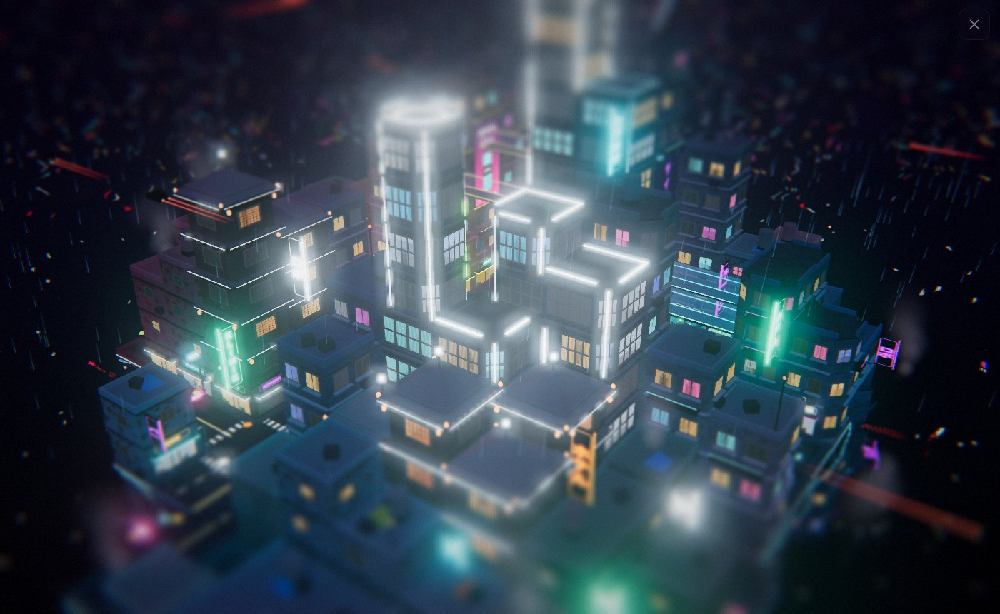
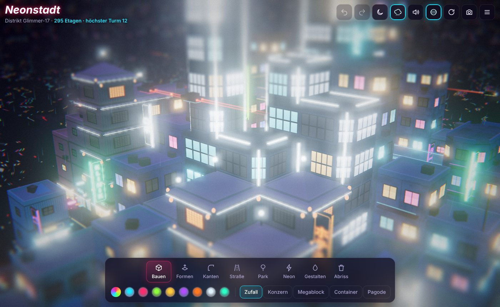

# Neon City

Ein ruhiges Aufbauspiel im Browser: Du baust eine Neon-Megastadt auf nassem, spiegelndem Wasser. Es gibt kein Geld, keine Ziele und keinen Druck, nur Bauen, Formen und Zuschauen. Vorbilder sind [Townscaper](https://store.steampowered.com/app/1291340/Townscaper/), [Altstadt](https://store.steampowered.com/app/5123730/Altstadt/) und [Miniopolis](https://store.steampowered.com/app/3814960/miniopolis/).





## Spielen

Die Seite besteht aus einer einzigen Datei, `index.html`. Die Bibliotheken kommen vom CDN, darum braucht sie beim Laden Internet.

```sh
python3 -m http.server 8000   # dann http://localhost:8000 öffnen
```

Das Spiel läuft auch als Claude-Artefakt. Über GitHub Pages lässt es sich direkt aus dem Hauptordner ausliefern.

## Steuerung

| | Maus und Tastatur | Touch |
|---|---|---|
| Werkzeug anwenden | Linksklick | Tippen |
| Fläche aufziehen, Push/Pull | Linke Taste gedrückt ziehen | Mit einem Finger ziehen |
| Geklickte Etage abreißen | Rechtsklick | Lange drücken |
| Drehen | Rechte Taste ziehen oder `Q` / `E` halten | Zwei Finger |
| Zoomen | Mausrad oder `+` / `−` halten | Zwei Finger auseinander |
| Schieben | `WASD` oder Pfeiltasten halten (mit `Shift` schneller), mittlere Maustaste | – |

Die Kamera gleitet beim Halten der Tasten weich los und rollt nach dem Loslassen aus.

Bewegst du die Maus gut 3 Sekunden nicht, blendet sich die Oberfläche aus und der Mauszeiger verschwindet. Mausbewegung, Tippen oder eine Taste holen sie zurück; die Kamerasteuerung mit der Tastatur zählt nicht dazu, so kannst du ohne Leisten durch die Stadt fahren. Ruht die Maus über einer Leiste oder ist das Menü offen, bleibt alles sichtbar. Tippst du auf eine ausgeblendete Leiste, erscheint sie nur und es wird nichts darunter gebaut.

## Tageszeit und Wetter

- **Zeitregler** oben in der Mitte: links der Mond für Mitternacht, die Sonne markiert Mittag, rechts steht die Uhrzeit. Ziehen stellt die Tageszeit in 5-Minuten-Schritten; Himmel, Licht, Nebel, Wasser und Fenster folgen sofort. Morgens und abends steht die Sonne tief und wirft lange Schatten, nachts übernimmt der Mond. Tagsüber brennt nur noch in wenigen Wohnungen Licht, die Scheiben spiegeln den Himmel stärker und das Neon leuchtet schwächer. Die Zeit bleibt stehen, wo du sie hinstellst.
- **Wetter** (Wolken-Knopf oben rechts): ein Menü zum Ankreuzen, mehrere Wetter gleichzeitig sind möglich. Jedes blendet in gut 2 Sekunden ein oder aus.
  - **Regen**: Regenfäden, Ringe auf dem Wasser, Schirme bei den Fußgängern, Rauschen.
  - **Gewitter**: dunkler Himmel, Blitze in unregelmäßigen Abständen, oft doppelt, mit sichtbarem Blitz am Horizont und verzögertem Donner.
  - **Schnee**: treibende Flocken; Dächer, Straßen und Parks werden in etwa 30 Sekunden weiß und tauen danach langsam wieder.
  - **Nebel**: dichter, heller Dunst, Neon bekommt Lichthöfe.
  - **Smog**: gelbgrüner Dunst; zusammen mit Regen wird daraus Säureregen.
  - **Polarlicht**: wehende grüne und violette Bänder am Nachthimmel, tagsüber unsichtbar.
- Die Zahl am Wolken-Knopf zeigt, wie viele Wetter an sind, sobald es mehr als eines ist.

Weitere Tasten: `1`–`8` Werkzeuge, `Strg+Z` / `Strg+Y` Rückgängig und Wiederholen, `T` Tilt-Shift, `N` nächste Tageszeit (Morgen, Mittag, Abend, Nacht), `R` Regen, `M` Ton, `Leertaste` Rundflug, `P` Fotomodus, `Esc` abbrechen.

## Werkzeuge

- **Bauen**: Ein Klick aufs Wasser oder aufs Dach setzt einen Block, ein Klick auf eine Unterseite setzt ihn darunter. Klickst du an eine Wand, landet der Block im Nachbarfeld auf genau dieser Höhe; steht dort nichts darunter, ragt er frei aus (**Überhang**). Mit Ziehen entsteht ein Rechteck auf der Höhe, an der du ansetzt, zum Beispiel ein 4×4-Block auf dem Wasser oder eine Platte, die von einer Fassade aus über die Straße ragt.
- **Formen** (Push/Pull wie in Miniopolis): Du greifst ein Dach, eine Unterseite oder eine Fassade und ziehst. Dächer gehen hoch oder runter, Unterseiten wachsen nach unten oder werden hochgeschoben, Fassaden schiebst du Felder weit raus oder rein. Die betroffene Fläche leuchtet beim Zeigen auf und wandert beim Ziehen mit. Im Dock wählst du, was du greifst:

  | Auswahl | an der Fassade | auf Dach oder Unterseite |
  |---|---|---|
  | **Fläche** | die ganze Fassade dieses Gebäudes | die zusammenhängende Dachfläche gleicher Höhe |
  | **Etage** | nur diese eine Etage über die ganze Fassade, raus gezogen ergibt das eine auskragende Platte | alle Dachfelder des Gebäudes auf dieser Höhe |
  | **Reihe** | ein senkrechter Streifen von einem Feld Breite | eine Reihe von Feldern, waagerecht im Bild |
  | **Block** | ein einzelnes Feld auf dieser Etage | ein einzelnes Feld |
- **Kanten**: Außenecken werden **eckig**, **schräg**, **rund** (nach außen gewölbt) oder **hohl** (nach innen gezogen). **Innenecken** von L- oder U-förmigen Gebäuden werden schräg oder rund ausgefüllt. Ein Klick auf die Dachmitte ändert das ganze Gebäude, Ziehen eine ganze Fläche.
- **Straße**: Wahlweise Straße oder Platz. Zwei Straßenfelder nebeneinander werden eine **breite Straße** mit doppelter Mittellinie, gestrichelten Fahrstreifen und Zebrastreifen an Kreuzungen. Auf einem Gebäude wird das Erdgeschoss zum Durchgang mit Neon-Bogen.
- **Park**: Leuchtbäume und Glühwürmchen.
- **Neon**: Ein Klick auf eine Fassade setzt ein Leuchtschild, ein Klick aufs Dach schaltet die Werbetafel an oder aus.
- **Gestalten**: Färbt das ganze Gebäude um oder wechselt den Stil, je nach Auswahl im Dock.
- **Abriss**: Ein Klick nimmt genau die geklickte Etage weg, auch aus der Mitte eines Turms; so entstehen Löcher und Überhänge. Mit Ziehen wird alles im Rechteck ab dieser Höhe abgeschnitten.

Farben und Stile (Konzern, Megablock, Container, Pagode) wählst du im Dock. Bei „Zufall“ übernehmen Anbauten den Stil des Gebäudes, an das du baust.

## Was sich von selbst ergibt

Nachbarn gleicher Farbe und gleichen Stils verschmelzen zu einem Gebäude. Je nach Lage entstehen dann:
- Läden mit Markise an Straßen, Plätzen und Parks,
- Leuchtschilder, große Hochformat-Werbung an hohen Fassaden, Klimageräte, Balkone, Vordächer mit Lampions,
- auf den Dächern Wassertanks, Antennen mit Blinklicht, Helipads und Werbetafeln,
- Licht unter Überhängen und **Stützen** je nach Länge des Überhangs:
  - ein Feld weit: schlanke L-Verbinder an den beiden Ecken der tragenden Wand, damit die Fenster frei bleiben,
  - länger: alle zwei Felder eine Stütze, vom äußeren Ende gezählt (2 Felder → unter Feld 2, 3 → 3, 4 → 2 und 4, 5 → 3 und 5, 6 → 2, 4 und 6 …),
  - über einer Straße statt der Stütze ein Portal mit Pfosten am Straßenrand; bei breiten Straßen über beide Spuren,
  - ganz frei schwebende Teile stehen auf Stützen bis zum Boden oder ins Wasser,
  - jeder Stil hat eigene Stützen: Konzern schlanke Stahlsäulen mit Leuchtringen und leuchtender Strebe, Megablock Betonpfeiler mit Kapitell und Betonkonsolen, Container rostige Stahlpfeiler mit Flanschplatten und orangem Warnband, Pagode rote Säulen und Torii-Portale mit Konsolen und Lampions,
- Simse zwischen den Etagen und Fensterbänke aus Beton,
- Glas-Skywalks zwischen Türmen und Lampionketten zwischen Containern,
- Suchscheinwerfer auf den höchsten Türmen.

Das Startviertel hat zweispurige Hauptachsen mit Brückenhäusern darüber, Nebenstraßen mit Durchgängen, einen Platz mit Hologramm und Gebäude, die übers Wasser auskragen. Autos fahren auf den Straßen (Rechtsverkehr), fliegende Autos suchen sich ihre Höhe über den Dächern, Fußgänger gehen auf Straßen und Plätzen.

## Technik

- **three.js 0.170.0** als ES-Modul über eine Importmap von jsDelivr, dazu OrbitControls, `Reflector` für das Wasser (Wellen- und Regenverzerrung, Nebel im Shader; Regen und Vorschau werden nicht gespiegelt), `EffectComposer` mit `UnrealBloomPass`, `OutputPass`, zwei Tilt-Shift-Pässen und einem eigenen Pass für Farbsaum, Sättigung, Vignette, Körnung, Scanlines und Glitch.
- **Tilt-Shift**: Ein 9-Tap-Weichzeichner, getrennt nach waagerecht und senkrecht. Er beginnt erst außerhalb eines scharfen Bandes, und dieses Band folgt dem Blickpunkt der Kamera. Dazu kommt etwas mehr Sättigung für den Miniatur-Look.
- **GSAP 3.12.5** für den Kameraflug beim Start und den Sprung zur nächsten Tageszeit (`lagSmoothing(0)`, damit langsame Geräte nicht hängen bleiben).
- **Tone.js 14.8.49** für Synth-Pad, Bass und Regenrauschen. Jede Etage spielt beim Bauen einen höheren Ton der Pentatonik.
- **Stadtmodell**: Jedes Feld hat eine Bodenart `g` und eine Etagen-Maske `m`, in der Bit `k` für Etage `k` steht. Damit sind Überhänge, Löcher, Durchgänge und Brücken dasselbe: Etagen, unter denen nichts liegt.
- **Rendering**: Jede Bauteilart ist ein `InstancedMesh`-„Eimer“ mit einem Draw-Call, insgesamt 65 Eimer. Leere Eimer werden nicht gezeichnet. Nach jeder Änderung wird die ganze Stadt aus dem Raster neu aufgebaut, das sind höchstens 20 × 20 × 18 Felder. Ein in `onBeforeCompile` eingesetzter Vertex-Shader lässt geänderte Etagen federnd aufploppen: Drehpunkt und Zeitpunkt je Instanz, und nur ab der geänderten Etage. Fassaden bekommen Welt-UVs, damit Texturen über verschmolzene Gebäude und runde Ecken durchlaufen. Ein Streulicht-Term färbt Wände in Bodennähe mit Neon ein.
- **Fassaden**: Jeder Stil hat eine eigene 512er-Textur mit passender Höhen- und Rauheitskarte: Konzern Metallpaneele mit Deckenbändern, Megablock Beton mit Fugen, Rissen und Regenschlieren unter den Fenstern, Container Wellblech mit Rost und Schablonenschrift, Pagode Holzbretter mit lackierten Balken. Höhen- und Rauheitskarte laufen über dieselben Welt-UVs wie die Farbe. Die Gebäudefarben sind entsättigt, die Nachtbeleuchtung von oben ist gedämpft, damit Dächer dunkelgrau statt lila wirken.
- **Innenraum-Shader** (Interior Mapping): Hinter jeder Scheibe liegt ein gedachter Raum, größer als das Fenster. Der Blickstrahl trifft Rückwand, Seitenwand, Boden oder Decke; daraus entstehen Schrank, Bild, Fernseher, Teppich und Deckenlampe, in Läden Regale mit Waren. Kanten sind weich gezeichnet, der Raum verschwimmt nach hinten im Dunst, und mit der Entfernung bleiben nur Lichtfarbe und Helligkeit übrig. Manche Fenster haben Vorhänge oder Jalousien, die Scheibe spiegelt den Himmel.
  - **Silhouetten**: In vielen hellen Räumen steht oder sitzt jemand. Wer steht, bleibt eine Weile, geht weiter und verlässt manchmal den sichtbaren Teil des Raums. Die Figur wirft einen weichen Schatten auf die Rückwand, hinter Vorhängen sieht man nur den Schatten.
  - **Licht an und aus**: Jedes Fenster schaltet in seinem eigenen Takt (8 bis 30 Sekunden) an oder aus, beim Einschalten flackert die Röhre kurz. Ab und zu geht auch in einem dunklen Fenster Licht an. Fernseher tauchen den Raum in wechselndes blaues Licht.
  - Der Zufallswert je Fenster kommt als `flat`-Varying aus der Position der Instanz, damit er über die Fläche nicht rauscht.
- **Eckformen**: Ein Stockwerk mit geformter Ecke besteht aus vier Viertel-Prismen (eckig, schräg, rund, hohl), die je nach Ecke gedreht und skaliert werden. Innenecken bekommen ein Füllstück im leeren Diagonalfeld (Dreieck oder Viertelkreis-Hohlkehle). Die Fenster der angrenzenden Wände werden passend gekürzt.
- **Straßen**: Jedes Straßenfeld wird eingeordnet als gerade (x oder z), Kreuzung oder Ende/Kurve. Dafür zählen nur Straßenfelder, Plätze daneben ändern die Einordnung nicht. Zwei gerade Felder gleicher Richtung nebeneinander ergeben eine breite Straße. Liegt in Fahrtrichtung eine Kreuzung oder ein Platz, kommt ein Zebrastreifen dazu.
- **Tageszeit**: Neun Stützpunkte über 24 Stunden (Nacht, späte Nacht, Morgendämmerung, Sonnenaufgang, Vormittag, Nachmittag, Abendsonne, Dämmerung, Nacht) halten Himmelsfarben, Nebel, Halbkugel- und Richtungslicht, Bloom, Neon-Streulicht, Wasserfarbe, Sterne, Tageslichtanteil, Umgebungslicht und Belichtung. Dazwischen wird weich überblendet. Das Richtungslicht wandert als Sonne von Osten nach Westen und nachts als Mond; für Tag und Nacht gibt es je eine eigene Umgebungskarte. Der Himmel zeichnet eine Sonnenscheibe mit Hof.
- **Wetter**: Jedes Wetter hat einen Wert von 0 bis 1, der weich nachläuft. Nach der Tageszeit verändert jedes aktive Wetter die Werte (Nebeldichte, Farben, Licht), deshalb lassen sie sich frei kombinieren. Schnee liegt über einen eigenen Wert in allen Standard-Materialien auf Flächen, die nach oben zeigen. Polarlicht und Blitzschein sitzen im Himmels-Shader.
- **Stützen**: Eine Breitensuche je Etage geht von den getragenen Feldern aus, also Feldern mit einer Etage darunter. Sie misst für jede Überhang-Unterseite den Abstand `t` und die Länge `n` der Reihe nach außen. Bei `n = 1` entstehen L-Verbinder an den Wandecken, sonst eine Stütze, wenn `t ≥ 2` und `n − t` gerade ist.
- **Zufall**: Alles, was zum Bau gehört, kommt aus einem Hash von Feld, Etage und Richtung. Dieselbe Stadt sieht deshalb nach dem Laden genauso aus. `Math.random` steuert nur die Optik, also Partikel, Fensterflackern, Verkehr und Texturen.

### Spielstand

- Wird automatisch in `localStorage` gespeichert, Schlüssel `neonstadt-v2` (der Name stammt aus der Zeit vor der Umbenennung und bleibt, damit gespeicherte Städte erhalten bleiben). Ein alter Stand unter `neonstadt-v1` wird beim ersten Start gelesen und umgebaut. Effektstufe und Tilt-Shift liegen unter `neonstadt-q` und `neonstadt-tilt`, Tageszeit und Wetter unter `neonstadt-tageszeit` und `neonstadt-wetter`.
- Format 2: `{v:2, app:'neonstadt', n:20, name, cells:[[index, g, m, s, c, schilder?, werbetafel?, ecken?], …]}`. Dabei ist `g` die Bodenart (0 Wasser, 1 Straße, 2 Park, 3 Platz) und `m` die Etagen-Maske. `s` ist der Stil, `c` die Farbe, `schilder` eine Liste von `[Richtung, Etage, Motiv]` und `ecken` die Form der vier Ecken (0 eckig, 1 schräg, 2 rund, 3 hohl).
- Format 1 (`[index, k, h, s, c, a, …]` mit Höhe `h` und Durchgang `a`) wird beim Laden in eine Maske umgerechnet.
- Der **Stadt-Code** im Menü ist das JSON als Base64 mit dem Präfix `NEON2:`. Codes mit `NEON1:` und reines JSON werden ebenfalls angenommen. Beim Laden werden alle Felder geprüft und begrenzt.

### Testschnittstelle

`window.NEON` bietet `G`, `idleState`, `setHour`, `hour`, `setWeather`, `wth`, `nextDaytime`, `AP`, `setPullMode`, `roadAxis`, `rebuild`, `snap`, `load`, `restore`, `pick`, `makePlan`, `rectPlan`, `extrude`, `pullApply`, `regionOf`, `topRegion`, `botRegion`, `sideRegion`, `undo`, `redo`, `setTool`, `generate`, `project`, `setQuality`, `setTilt`, `tiltOn`, `killIntro`, `topOf`, `rng`, `segOf`, `hl`, `gcars`, `STATS`, `B`, `camera` und `controls`.

## Prüfen

```sh
pip install playwright && python3 -m playwright install chromium
python3 tests/pruefung.py            # Screenshots landen im Temp-Ordner
```

Das Skript holt die Bibliotheken per `npm pack` und leitet die CDN-Adressen auf diese Kopien um. Dann prüft es 47 Punkte, darunter:
- Startviertel und Autos auf den Straßen,
- 4×4-Fläche als ein Gebäude,
- Push/Pull an Dach und Fassade samt leuchtender Fläche,
- die vier Auswahlarten Fläche, Etage, Reihe und Block an Fassade und Dach,
- Abrunden und Undo/Redo,
- Stadt-Code-Rundreise und Umbau von Format 1,
- Überhang per Seitenklick, Etage aus der Mitte abreißen,
- gefüllte Innenecke und Hohlkehle,
- L-Verbinder, Stützenabstände 2, 3, 2-4, 3-5, 2-4-6, Portal über einer breiten Straße,
- Straße neben einem Platz bleibt gerade,
- Abriss-Rechteck,
- weiches Gleiten mit der Tastatur, Tilt-Shift-Schalter,
- Ausblenden der Oberfläche ohne Mausbewegung, Zurückholen per Klick ohne zu bauen, sichtbar bleiben über der Leiste,
- Titel „Neon City“,
- Zeitregler (Mitte = Mittag, Tageslicht), Wetter-Menü mit Mehrfachauswahl, alte Knöpfe für Regen und Stimmung entfernt,
- Tippen am Handy,
- keine Seitenfehler.

**Stand 2026-11-26** (Commit mit diesem README):
- **Ausgeführt:** alle 47 Prüfungen grün, dazu `tests/strassenleben.py`, in Headless-Chrome mit Software-WebGL (SwiftShader) bei 1400×860 und 390×844.
- **Angesehen:** Morgen, Mittag, Abend und Nacht; Schnee, Nebel (Tag und Nacht), Smog (Tag und Nacht), Gewitter und Polarlicht; das Wetter-Menü auf Desktop und Handy.
- **Nicht geprüft:** die Bildrate auf echter Grafikkarte (der Innenraum-Shader kostet pro Fensterpixel etwas mehr als vorher), der Ton (headless startet kein AudioContext) und echtes Safari auf iPhone oder iPad.
- Läuft es zu langsam, schaltet das Spiel nach etwa 6 s unter 24 fps selbst auf „Effekte: Schonend“ (ohne Spiegelung, Schatten und Kantenglättung). Auf Touch-Geräten ist das die Grundeinstellung. Tilt-Shift lässt sich mit `T` oder im Menü ausschalten.

## Herkunft

- Gebaut mit Claude am 2026-11-25.
- Techniken aus [tomkpunkt/gamedev](https://github.com/tomkpunkt/gamedev):
  - [Pointer Events für Maus und Touch](https://github.com/tomkpunkt/gamedev/blob/main/techniken/touch-pointer-eingabe-sandbox/README.md) (Tippen und Ziehen trennen, lange drücken, zwei Finger brechen eine Geste ab)
  - [Undo als Schnappschuss](https://github.com/tomkpunkt/gamedev/blob/main/techniken/sandbox-editor-grundfunktionen/README.md)
  - [Speichern in Claude-Artefakten](https://github.com/tomkpunkt/gamedev/blob/main/techniken/claude-artifact-persistenz/README.md) (`localStorage` mit try/catch, ehrliche Rückmeldung, Code statt Download)
  - [Spielstände mit Migration](https://github.com/tomkpunkt/gamedev/blob/main/techniken/spielzustand-schreibgrenze-spielstaende/README.md) (Format 1 wird weiter gelesen)
  - [Zufall trennen](https://github.com/tomkpunkt/gamedev/blob/main/techniken/golden-master-umbau-absichern/README.md) (Logik und Optik)
  - [Playwright mit Bibliotheken aus npm](https://github.com/tomkpunkt/gamedev/blob/main/techniken/playwright-canvas-pruefung/README.md)
- Alle Schilder, Werbetafeln und Namen sind frei erfunden. Es stecken keine Inhalte, Namen oder Logos aus Cyberpunk 2077 darin.
